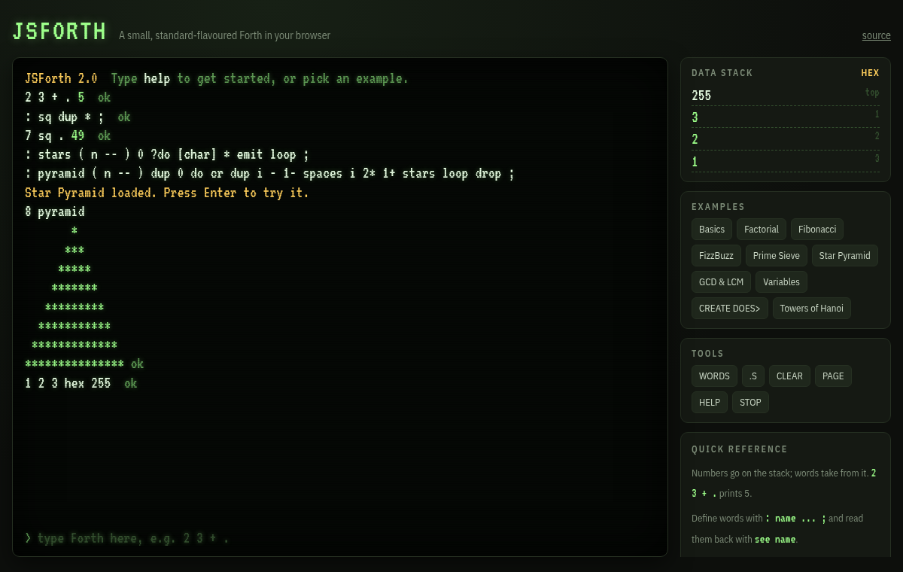

# JSForth

[](https://github.com/cstroie/forth/actions/workflows/test.yml)

A small Forth that runs in the browser, close to the standard. Colon definitions are compiled, there's a real return stack and proper control flow, and the terminal shows the data stack live. There are no dependencies and no build step.

**Live demo: https://cstroie.github.io/forth/**



## Quick start

```forth
2 3 + .                 \ 5
: square ( n -- n*n ) dup * ;
7 square .              \ 49
: countdown ( n -- ) begin dup . 1- dup 0= until drop ;
5 countdown             \ 5 4 3 2 1
```

Type `help` for an overview, `words` to list every word, and `see name` to show a definition. The **Examples** panel loads ready-made programs:

- Factorial
- Fibonacci
- FizzBuzz
- a prime sieve
- a star pyramid
- GCD and LCM
- variables
- `CREATE … DOES>` arrays
- a countdown using `ms`
- floating point
- dice rolling with `CASE` and `KEY`
- number formatting with `<# #>`
- Towers of Hanoi

## Words

| Area | Words |
|------|-------|
| Stack | `dup drop swap over rot -rot nip tuck pick roll ?dup 2dup 2drop 2swap 2over depth clear >r r> r@` |
| Arithmetic | `+ - * / mod /mod */ negate abs min max 1+ 1- 2* 2/ and or xor invert lshift rshift random` |
| Comparison | `= <> < > <= >= 0= 0<> 0< 0> u< within true false` |
| Output | `. u. .r .s ? emit cr space spaces type ." .( page` / `cls`, `decimal hex binary` |
| Control | `if else then`, `do ?do loop +loop i j leave unloop`, `begin until again`, `begin while repeat`, `case of endof endcase`, `recurse exit` |
| Defining | `: ; variable constant value to create allot , c, does> ' ['] execute literal char [char]` |
| Memory | `@ ! +! c@ c! 2@ 2! here cells cell+ chars char+ 2variable 2constant` |
| Compiler | `immediate postpone [ ] literal compile, marker forget` |
| Formatting | `<# # #s hold sign #>`, `s>d d.` |
| Input and time | `key key? accept ms` |
| Floating point | `f+ f- f* f/ f** fnegate fabs fsqrt fsin fcos ftan fatan fexp fln flog floor fround fmin fmax`, `fdup fdrop fswap fover frot fdepth`, `s>f f>s f= f< f0= f0< f. f.s pi f@ f! fvariable fconstant` |
| Strings and comments | `." text"`, `s" text"`, `( comment )`, `\ comment` |
| Tools | `words see help cold` |
| Storage | `save name`, `load name`, `files`, `delete name` |

How it behaves:

- Cells are 32-bit signed integers, and `true` is `-1`. `/` and `mod` round toward negative infinity (floored division).
- Floating-point numbers live on a separate float stack. A number with a decimal point or an exponent (`1.5`, `2e0`) is a float.
- Numbers are read in the current `base`. A prefix overrides it: `$FF` is hex, `#10` decimal, `%101` binary, and `'a'` is a character code.
- Word names are case-insensitive.
- Redefining a word doesn't change words already compiled with the old version.
- On an error, the stacks are cleared and any unfinished definition is discarded, as standard `ABORT` does. The message points at the word that failed, for example `2 3 >>>foo<<<`.

## Browser features

- `key` waits for a keystroke, `accept` reads a typed line, and `ms` pauses without freezing the page.
- `Tab` completes word names. `↑`/`↓` scroll through history. `Esc` or `Ctrl+C` interrupts a runaway word: the interpreter runs in time slices, so `begin again` can't freeze the page.
- Pasting several lines enters each one in turn.
- Every definition you make is kept in localStorage and replayed on your next visit. `cold` starts from scratch.
- **SHARE** copies a link with your definitions packed into the address. Opening the link recreates those words in a fresh dictionary.

## Install and offline use

The page is a Progressive Web App. Your browser offers to install it (on a phone, use **Add to Home Screen**). After the first visit it also works offline: a service worker (`sw.js`) caches the app and refreshes it in the background, so updates appear on the next visit.

## Layout

- `forth.js` holds the interpreter: outer interpreter, compiler, inner interpreter and the built-in words. It doesn't touch the DOM, so it can run in Node:

  ```js
  const { Forth } = require('./forth.js');
  const storage = { get: () => null, set: () => true, remove() {}, keys: () => [] };
  const f = new Forth(text => process.stdout.write(text), storage);
  f.enter(': sq dup * ; 12 sq .');
  f.runSlice();          // prints "144  ok"
  ```
- `index.html` holds the terminal user interface.

## Tests

```
node --test
```

The tests run the interpreter core under Node (version 18 or later) with no dependencies. GitHub Actions runs them on every push.

## History

This started as a fork of [eatonphil/jsforth](https://github.com/eatonphil/jsforth) (2013–2015), a micro-Forth Phil Eaton wrote for a programming-languages course. Version 2 is a complete rewrite. The original passed words around as strings and re-interpreted them; this version compiles definitions into code, runs them on an inner interpreter, and uses standard Forth behaviour throughout.

Programs saved with the old `save` command can still be loaded with `load`.

## License

[MIT](LICENSE.md). Original © Phil Eaton, rewrite © Costin Stroie.
